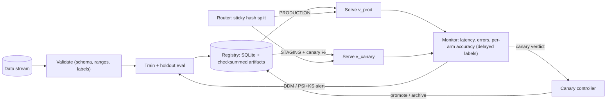

# mlops-pipeline

A hand-built MLOps platform: **model registry** with guarded promotion, **drift detection** (PSI, KS, DDM), **automated retraining**, and **canary deployment** with statistical auto-promote / auto-rollback, all wired into a closed loop and served through FastAPI.

[](https://github.com/Alkarim786/mlops-pipeline/actions/workflows/ci.yml)


> Project 27 of Karim's 30 Days, 30 Projects series.

## Why this exists

Training a model is the easy part. In production the data drifts, labels arrive late, a retrained model can be *worse* than the one it replaces, and a bad release has to be undone fast. Tools like MLflow and Argo Rollouts solve these, but using them does not show you understand them. This project builds each piece from first principles (no MLflow) so every design decision is visible, tested and explainable.

## Architecture



**Data flow.** Every request goes through `ServingEngine.predict`: a SHA-256 hash of the request id picks the arm (production or candidate), so a given id always lands in the same arm. Predictions are remembered by request id; labels that arrive later via `/feedback` are joined back to the arm that served them, giving **per-arm live accuracy**. Production-arm errors feed a DDM concept-drift detector; batches of features are compared to the model's stored reference sample with PSI + KS. An alert starts a *collecting* phase (gather enough post-drift labelled rows), then the pipeline validates, trains, evaluates, and registers a new version, stages it and starts a canary at a fixed traffic fraction. The `CanaryController` compares arms with a one-sided statistical test and either promotes (atomically archiving the old production version) or archives the candidate; `refresh()` hot-reloads models without a restart.

## Tech stack

| Choice | Why |
|---|---|
| Python, scikit-learn (HistGradientBoosting) | Small, fast to train on CPU; the platform is the point, not the model. |
| SQLite (registry metadata) + local filesystem (artifacts) | Zero-ops, transactional stage changes; the artifact I/O is isolated so S3/MinIO is a drop-in. |
| FastAPI | Typed request validation, auto docs at `/docs`, easy `TestClient` tests. |
| NumPy/SciPy | PSI and DDM are ~30 lines each and written by hand; SciPy only for the KS test. |
| Docker Compose | One command for the API; a `demo` profile for the full loop. |

## Features (implemented)

- **Registry**: versions with metrics, params, data hash, git SHA, reference sample; stages `NONE -> STAGING -> PRODUCTION -> ARCHIVED`; SHA-256 artifact verification on load; atomic promotion that archives the previous production version; `rollback()`; event log; offline promotion **guard** (`candidate >= production - epsilon`).
- **Validation**: hand-written schema/range/NaN/label-balance checks that block training on bad data.
- **Training pipeline**: validate -> stratified split -> train -> holdout metrics -> register.
- **Serving**: FastAPI `/predict`, `/feedback`, `/registry/*`, `/canary/*`, Prometheus-format `/metrics`; hot reload on promotion/rollback.
- **Canary**: sticky hash routing, per-arm latency/error/accuracy stats, non-inferiority promote rule, significance-based rollback, error-rate and latency rollback, forced decision at a sample cap.
- **Drift**: PSI + KS for data drift, DDM (hardened, see below) for concept drift on delayed labels.
- **Closed-loop simulator** with three scenarios, including fault injection.

## Roadmap (not built)

- Feature-store integration and shadow deployments (mirror traffic, no user impact)
- Kubernetes manifests with Argo Rollouts, progressive traffic steps (5% -> 25% -> 50%)
- ADWIN as a second concept-drift detector; per-feature drift attribution in the alert
- S3/MinIO artifact backend and Postgres registry; scheduled retraining (APScheduler / cron)
- Prometheus + Grafana wiring (the text endpoint exists, the dashboards do not)

## Quick start

```bash
docker compose up --build            # API on http://localhost:8000  (Swagger UI at /docs)
curl -s localhost:8000/health
curl -s -X POST localhost:8000/predict -H 'content-type: application/json' \
     -d '{"request_id":"r1","features":[1,1,0,0,0,0]}'
curl -s -X POST localhost:8000/feedback -H 'content-type: application/json' -d '{"request_id":"r1","label":1}'
docker compose --profile demo run --rm demo     # the full closed-loop demo
```

Local dev (Python 3.10+):

```bash
python -m venv .venv && source .venv/bin/activate     # Windows: .venv\Scripts\activate
pip install -r requirements.txt
python -m mlops.simulate --scenario concept_drift      # ~1 minute per scenario on CPU
MLOPS_ROOT=./registry-data python -m mlops.bootstrap && uvicorn --factory mlops.app:_default_app
```

## API reference

| Endpoint | Purpose |
|---|---|
| `POST /predict` `{request_id, features[]}` | `{prediction, probability, version, arm, latency_ms}` |
| `POST /feedback` `{request_id, label}` | attach a delayed ground-truth label (404 if unknown/expired) |
| `GET /registry/{name}/versions` | all versions with metrics, stage, data hash, git SHA |
| `POST /registry/{name}/versions/{v}/stage` `{stage, reason}` | transition; `409` if the metric guard rejects, `400` if illegal |
| `POST /registry/{name}/rollback` | restore the previous production version |
| `POST /canary/{v}` `{fraction}` | start a canary for a STAGING version |
| `POST /canary/evaluate` | run the decision now; applies promote/rollback |
| `GET /metrics` | Prometheus text: requests, errors, labelled/correct per arm, p95 latency, reloads |
| `GET /health` | production and candidate versions |

## Testing

```bash
pytest -q          # 34 tests, ~80 s (the end-to-end loop tests train several models)
ruff check .
```

Covered: registry stage machine and guard (including "rejected promotion changes nothing"), checksum tamper detection, rollback; routing proportions (within 4 sigma of Binomial) and stickiness, monotone fractions; PSI/KS on synthetic shifts and false-alarm rate on stationary data; DDM detection delay and false-alarm rates; canary decision table (wait, promote, non-inferior, rollback on accuracy/errors/latency, forced decision); hot reload; full canary lifecycle against the real registry; the HTTP API; and two end-to-end loop tests (concept drift recovers; a faulty candidate is rolled back and a clean retrain wins). Ran locally on Windows (Python 3.13) and in CI on Ubuntu (Python 3.12); the Docker image was built and the API smoke-tested.

## Results (measured on this PC)

Hardware: AMD Ryzen 5 7520U (4C/8T), 15.2 GB RAM, Windows 11, CPU only, `OMP_NUM_THREADS=1`. Synthetic 6-feature binary stream, 100 requests per step, labels delayed by 2 steps, 20% canary traffic, HistGradientBoosting. **Single run with seed 0; these are one sample, not averages**, so treat small differences as noise. Raw output: [docs/results.json](docs/results.json), [docs/run.log](docs/run.log). Reproduce: `python -m mlops.simulate`.

| Scenario (drift injected at step 40) | Alert (step, detector) | Detection delay | Retrain time | Canary decision | Accuracy before / during / after |
|---|---|---|---|---|---|
| Concept drift (label rule rotates) | 46, DDM | 6 steps = 600 requests | 0.29 s | promote at step 62 | 0.922 / 0.601 / 0.907 |
| Covariate shift (x0, x1 mean +2.5) | 41, PSI+KS | 1 step = 100 requests | 0.27 s | promote at step 62 | 0.922 / 0.538 / 0.913 |
| Moderate concept drift + **faulty first candidate** | 56, DDM | 16 steps = 1,600 requests | 0.42 s, then 0.23 s | **rollback at step 69** (cand 0.443 vs prod 0.783, p < 0.0001), clean retry **promoted at step 89** | 0.922 / 0.780 / 0.894 |

"During" is the mean accuracy from the drift until recovery (promotion); "after" is the last 20 steps. In the faulty-candidate run the bad model's *offline* holdout accuracy was 0.906 (it passed validation and registration); only live traffic exposed it, and it saw 20% of requests for 13 steps before rollback.

Drift-detector measurements (simulated error streams, `tests/test_drift.py`):

| Detector | Measurement | Result |
|---|---|---|
| Textbook DDM (warm-up 30) | false alarm within the first 100 samples after a reset, stationary 10% error | **24%** |
| Hardened DDM (warm-up 100, min +5pt error rise) | same, first 300 samples | **5.6%** (12% over 1,000 samples) |
| Hardened DDM | detection of 8% -> 40% error | 300/300 detected, median 65 samples |
| Hardened DDM | detection of 8% -> 20% error | 299/300, median 210 samples |
| Hardened DDM | detection of 8% -> 14% error | 254/300, median 556 samples |
| PSI+KS | false alarms, 40 stationary 500-row batches | <= 1 |

Honest reading: DDM is cheap and fast for big degradations but still false-alarms occasionally and detects small degradations slowly. That is acceptable here because **an alert only triggers a retrain, and the canary decides whether the candidate ships**, so a false alarm costs some compute and 20% traffic for a while, not a bad release.

## Key engineering decisions and trade-offs

- **Canary vs offline guard.** The registry's guard (candidate metric >= production - epsilon) protects manual promotions. A *canary* promotion deliberately bypasses it: after drift the production model's stored metric was measured on the old distribution and is stale (my first version used the guard on canary promotions and rejected clearly better candidates, 0.905 offline vs a stale 0.928, while live accuracy was 0.90 vs 0.55). Live A/B evidence on current traffic is the authority.
- **Non-inferiority, not "p > 0.05".** Promote only when the lower confidence bound of (candidate - production) clears -epsilon; roll back only on *significant* underperformance; otherwise keep collecting until a sample cap. This avoids both promoting on too little data and stalling forever on near-ties.
- **Sticky hash routing.** `sha256(request_id)` mod 1 means retries hit the same arm and a growing fraction only *adds* ids to the canary (tested), which keeps experiments clean.
- **Delayed labels.** Accuracy is only known after labels arrive, so decisions wait for `min_labelled` per arm and stats reset when a rollout starts so both arms cover the same window.
- **Retraining window.** The loop waits for enough post-drift labelled rows and starts from the estimated change point; my first version trained on a window that mixed pre- and post-shift rows, which produced a mixed reference sample and a cascade of retrains.
- **Reproducibility.** Each version stores the data SHA-256, git SHA, seed, hyperparameters and a reference sample; artifacts are checksummed. Caveat: artifacts are pickles (joblib), so only load registries you trust.
- **Atomicity.** Promotion archives the old production version and activates the new one in a single SQLite transaction; a rejected promotion leaves state untouched.

## Project structure

```
mlops/
  registry.py   data.py   validation.py   pipeline.py   drift.py
  canary.py     engine.py app.py          simulate.py   bootstrap.py
tests/          registry, drift/validation, canary/engine/HTTP, end-to-end loop
docs/           results.json, run.log
Dockerfile  docker-compose.yml  .github/workflows/ci.yml
```
